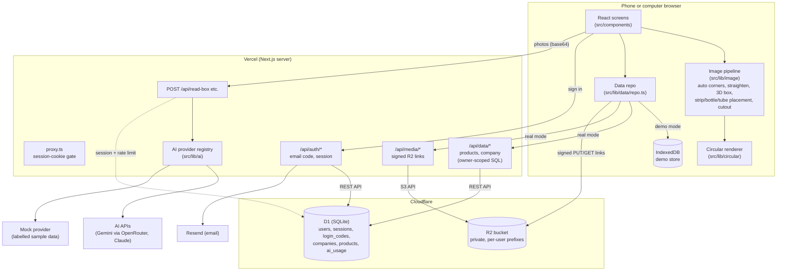
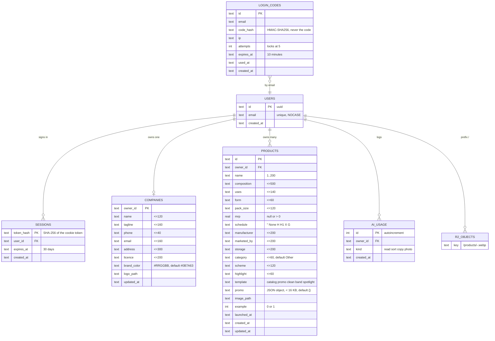
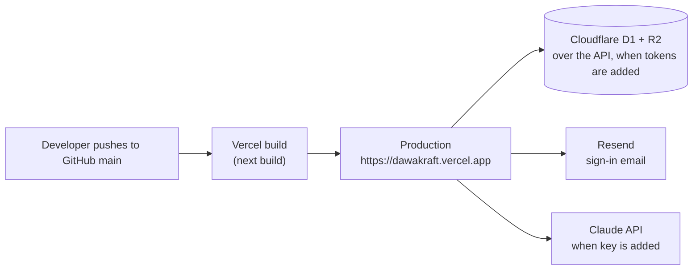

# Dawakraft architecture

> Status: living document. Last checked against the code on 2026-10-22.
> Decisions are recorded in [adr/](adr/README.md).

## 1. The stack, and why

| Layer | Choice | Version (package.json) | Why |
|---|---|---|---|
| Web framework | **Next.js App Router** | `next` 16.4.2 | One project for the public landing page, the app screens and the two small server functions that call the AI. Deploys to Vercel with no setup. |
| UI | **React** | 19.3.0 | Standard, well supported. |
| Language | **TypeScript** | ^5 | Catches mistakes before they reach users; shared types between browser and server. |
| Styling | **Tailwind CSS v4** plus hand-written CSS | `tailwindcss` ^4 | Tailwind provides the base and theme bridge; most styling is plain CSS classes driven by colour tokens in `src/app/globals.css` and `src/styles/*.css`. |
| Database | **Cloudflare D1** (SQLite) | REST API via `fetch`, no SDK | Free-tier serverless SQLite, reached from Vercel over Cloudflare's HTTP API ([ADR 0007](adr/0007-cloudflare-d1-r2-on-vercel.md)). |
| Photo storage | **Cloudflare R2** | `aws4fetch` 1.0.20 (presigned S3 links) | Private bucket, no egress fees; the browser uploads and downloads with short-lived signed links. |
| Sign-in | **Email code** (own code) + **Resend** | REST API via `fetch` | 6-digit code by email, session cookie; no third-party auth service. |
| AI reading | **Anthropic Claude** | `@anthropic-ai/sdk` ^0.135 | Reads printed carton text from photos and returns structured JSON. Model `claude-opus-5-5`. |
| Validation | **zod** | ^4.6.7 | One schema defines what the API accepts and what the AI must return. |
| Tests | **Vitest** | ^5.0.5 | Fast unit tests in Node. |
| Hosting | **Vercel** | n/a | Live at https://dawakraft.vercel.app, auto-deploys from GitHub `main` (set up in Vercel; there is no `vercel.json` in the repo). |

`next.config.ts` turns on `cacheComponents` and `partialPrefetching`, pins the Turbopack root to this folder and runs CSS through `@tailwindcss/turbopack`.

## 2. The big picture

Key idea: **almost everything happens in the browser.** Image processing, circular drawing, compliance checks and catalog sorting run on the phone. The server keeps the keys secret, applies sign-in and rate limits to AI calls, and stands between the browser and Cloudflare: it checks the session and scopes every query to the signed-in user.

## 3. Module map

### Routes (`src/app/`)

| Path | File | Who can open it | What it is |
|---|---|---|---|
| `/` | `page.tsx` | Everyone, indexed | Public landing page with JSON-LD. |
| `/catalog` | `(app)/catalog/page.tsx` → `components/Catalog.tsx` | Signed in (or demo) | Product grid, search and segments. |
| `/new` | `(app)/new/page.tsx` → `wizard/Wizard.tsx` | Signed in (or demo) | 5-step wizard. |
| `/product/[id]` | `(app)/product/[id]/page.tsx` → `ProductView.tsx` | Signed in (or demo) | Circular, share, download, delete. |
| `/product/[id]/edit` | `(app)/product/[id]/edit/page.tsx` | Signed in (or demo) | Wizard opened at step 3. |
| `/company` | `(app)/company/page.tsx` → `CompanyForm.tsx` | Signed in (or demo) | Branding. |
| `/import` | `(app)/import/page.tsx` → `ImportView.tsx` | Signed in (or demo) | CSV / paste import. |
| `/login` | `login/page.tsx` | Public, noindex | Two steps: email, then the 6-digit code (new code after 60 s). In demo mode it redirects to `/catalog`. |
| `/api/auth/start`, `/api/auth/verify`, `/api/auth/signout`, `/api/auth/me` | `api/auth/*/route.ts` | Public (rate limited) | Email-code sign-in and the session (section 6). |
| `/api/data/products`, `/api/data/products/bulk`, `/api/data/products/[id]`, `/api/data/company` | `api/data/**/route.ts` | Signed in | The catalog and company profile in D1 (section 5). |
| `/api/media`, `/api/media/upload-url` | `api/media/**/route.ts` | Signed in | Signed R2 links for photos; delete photos. |
| `/api/read-box` | `api/read-box/route.ts` | See section 5 | AI box reading. |
| `/api/categorize` | `api/categorize/route.ts` | See section 5 | AI category sorting for imports. |
| `/robots.txt`, `/sitemap.xml` | `robots.ts`, `sitemap.ts` | Public | SEO files. |
| `/opengraph-image` | `opengraph-image.tsx` | Public | 1200 × 630 share card. |
| `/icon.svg`, `/pwa-icon/[size]` | `icon.svg`, `pwa-icon/[size]/route.tsx` | Public | Favicon and home-screen icons (180, 192, 512). |
| `/manifest.webmanifest` | `manifest.ts` | Public | PWA manifest. |

All app screens share `(app)/layout.tsx`: `ToastProvider` → `DataProvider` → `AppBar` + `DemoBanner` + page. That layout sets `robots: noindex, nofollow`.

### Libraries (`src/lib/`)

| Module | Runs in | Purpose |
|---|---|---|
| `config.ts` | Both | Decides **demo mode**: `realMode` is true only when `NEXT_PUBLIC_DATA_BACKEND=cloudflare` (a plain switch, built into the browser code). `demoMode = !realMode`. Server-only `cloudflareReady()` also needs real `CLOUDFLARE_ACCOUNT_ID`, `CLOUDFLARE_D1_DATABASE_ID`, `CLOUDFLARE_D1_API_TOKEN` and `AUTH_SECRET` (32+ chars); if the switch is on but these are missing, the API routes answer 503 `not_configured`. `r2Settings()` is optional. A value counts only if `isRealValue` (not empty, not `your-…`/`example`/`placeholder`/`xxxx`). Also `claudeConfigured()` and `demoAiAllowed()`. |
| `ai/index.ts` | Server | **Provider registry.** `AI_PROVIDER=anthropic` → Claude (needs a real key, otherwise `not_configured`); `mock` → labelled sample answers; `off` → `not_configured`; unset or unknown → Claude if the key is real, otherwise mock. |
| `ai/types.ts` | Server (browser imports types only) | zod contracts: `BoxReadRequestSchema` (1–4 images, JPEG/PNG/WebP, base64 up to ~3 MB each, role front/side/top/other), `BoxReadingSchema` (11 fields, each `{value, confidence, source, quote}`), `CategorizeRequestSchema` (1–150 items), response envelopes `{ok:true,data,meta}` / `{ok:false,error}`, `AiProvider` interface with a `paid` flag. |
| `ai/providers/anthropic.ts` | Server | Claude via `beta.messages.parse` with zod structured output, `effort: medium` for reading and `low` for sorting, `max_tokens` 8000 / 16000, 2 retries, 90 s timeout, server-side fallback beta. Logs latency, tokens and an estimated USD cost to the server log. |
| `ai/providers/mock.ts` | Server | Fixed made-up carton ("Demozith 500"), every field `low` confidence, `meta.mock = true`, 600 ms delay; keyword-based sample categories. `paid: false`. |
| `ai/box-read.ts` | Both | The prompt, merging a reading into the form, evidence lines (`Read from side panel: "…"`), the "Sample reading" warning text. |
| `ai/access.ts` | Server | `checkAiAccess`: free providers skip checks; paid providers need a signed-in user (`getSession()`), local demo or the demo passcode, and must pass the rate limit. |
| `rate-limit.ts` | Server | In-memory window per server instance, plus `claimAiUse()` on D1's `ai_usage` table (insert then count, one request, owner-scoped). |
| `image/perspective.ts` | Both (pure) | Corner ordering, aspect estimate, homography, bilinear `warpToRect`, `quadShare` (share of a photo covered by a detected face), depth consistency between left end (`side`) and top (warns over 20% mismatch). |
| `image/corners.ts` | Browser | Finds the box edges automatically from the background flood-fill mask (no manual dragging); falls back to a rectangle 8% inside the photo edges. |
| `image/straighten.ts` | Browser | Canvas glue: loads face photos up to 1600 px, straightens to a long side of 1200 px. |
| `image/packshot.ts` | Browser | Builds the 3D box from the straightened front, left end and top (view from the left, low camera, soft shadow). Size check per face (`MIN_FACE_SHARE`: front 20%, end and top 5%): an untrusted face is trimmed, or the photo is used as photographed. Fills a missing end or top from the front's edge colours. "Photos are cropped to the box" skips detection. |
| `image/companion.ts` | Browser (layout pure) | Places the cut-out strip, bottle or tube in front of the box's right end, sized and tilted as in the company catalogue. `shotLayout` is pure and unit-tested; strips are turned upright and tubes flat automatically. |
| `image/cutout.ts` | Browser | Background removal by flood-fill from the edges (tolerance slider, default 46). |
| `image/encode.ts` | Browser | Image loading, product image as WebP/PNG, logo blob, AI images shrunk to JPEG base64. |
| `faces.ts` | Browser | Photo roles: Front, Left end (`side`), Top, Strip / bottle / tube (`pack`, with its pack type), Other side. Only one photo per role. The AI receives `pack` photos as `other`. |
| `compliance.ts` | Both (pure) | The step-4 checklist. |
| `composition.ts` | Both (pure) | Strength checks: misread letters (`5O0`), numbers with no unit, front strength vs composition (allows combination totals like 625 = 500 + 125). |
| `segments.ts` | Both (pure) | New launch (`NEW_LAUNCH_DAYS = 60`), highlight auto-removal, company grouping, filter matching. |
| `circular/draw.ts`, `circular/render.ts`, `circular/catalogCard.ts` | Browser | The four layouts (Catalogue card, Clean, Side band, Spotlight) at 1080 × 1350 and PNG export. |
| `csv.ts` | Both | CSV / tab-separated parsing with header aliases, max 500 rows. |
| `format.ts`, `share.ts`, `color.ts` | Both / browser | MRP text, WhatsApp message, catalog list, Web Share, download, clipboard, colour helpers. |
| `data/repo.ts` | Browser | **Single data entry point.** Every read and write checks `demoMode` and goes either to the app's `/api/data`, `/api/media` and `/api/auth` routes or to `data/demo-store.ts`. `friendlyError()` turns API error codes into plain English; a `not_signed_in` answer clears the cookie and goes to `/login`. |
| `data/demo-store.ts` | Browser | IndexedDB database `dawakraft-demo` with stores `products`, `company`, `media`. |
| `data/mappers.ts` | Both | Row ↔ object conversion, empty company and draft. |
| `cloudflare/d1.ts` | Server | D1 over the REST API: `query`, `run`, `batch` (many statements, one request), 10 s timeout, 2 retries on 429/5xx, `chunkRows` for the 100-parameter limit, errors classified as `constraint` / `bad_query` / `unauthorized` / `unavailable`. |
| `cloudflare/r2.ts`, `cloudflare/media-keys.ts` | Server | Presigned R2 PUT (5 min, content type signed) and GET (10 min) links with `aws4fetch`; photo keys `<user id>/<name>-<random>.<ext>` and `ownsKey()` (owner prefix, no `..`). |
| `auth/codes.ts`, `auth/session-token.ts`, `auth/email.ts`, `auth/server.ts` | Server | Code generation and HMAC hashing, attempts and expiry; session tokens and cookie options; Resend email (dev: console); `getSession()` (one query joining `sessions` and `users`). |
| `db/products.ts`, `db/company.ts`, `db/auth.ts`, `db/schemas.ts` | Server | Owner-scoped SQL builders (owner id always bound from the session), sign-in queries, and the zod schemas for the data API. |
| `api/respond.ts`, `api/media-cleanup.ts` | Server | `{ok,data}` / `{ok:false,error}` envelope, `withUser` (config check, same-origin check for writes, session, error mapping), body parsing with size caps; owner-only photo cleanup. |
| `site.ts` | Both | Site name, URL (`NEXT_PUBLIC_SITE_URL`, default `https://dawakraft.vercel.app`), title, description, private paths. |

### `src/proxy.ts` (runs before pages)

Next.js 16 calls this file "proxy" (formerly middleware).

- **Demo mode:** every path opens; `/login` redirects to `/catalog`.
- **Real mode** (`NEXT_PUBLIC_DATA_BACKEND=cloudflare`): visitors without a `dk_session` cookie are sent from the app screens (`/catalog`, `/new`, `/product`, `/import`, `/export`, `/company`) to `/login`; visitors with one are sent from `/login` to `/catalog`. It only looks for the cookie (no database call); every API route verifies the session itself.
- The matcher skips `_next/`, `api/`, `favicon.ico`, `manifest.webmanifest`, `sw.js`, `pwa-icon`, `icon` and `apple-icon`.

## 4. Data model

From `cloudflare/migrations/0001_init.sql` (D1 / SQLite; ported from the earlier Supabase migrations 0001–0004). Timestamps are ISO 8601 text in UTC.

- **Indexes:** `products (owner_id, created_at desc)`, `products (owner_id, launched_at desc)`, `ai_usage (owner_id, kind, created_at desc)`, `login_codes (email, created_at)`, `login_codes (ip, created_at)`, `sessions (user_id)`.
- **Foreign keys** (always enforced by D1) cascade: deleting a user removes their sessions, company, products and usage rows.
- **`launched_at`:** empty means an existing product. A product counts as a new launch for 60 days after this date (`segments.ts`); this is computed in the app, so nothing needs to run on a schedule.
- **No row-level security in D1.** Ownership is enforced in code: every statement in `src/lib/db/*` binds the session user's id as `owner_id`; upserts only update a row with the same owner (`ON CONFLICT (id) DO UPDATE … WHERE products.owner_id = excluded.owner_id`).
- **Photos:** R2 bucket, private, keys under `<user id>/` (`products/<product id>-…`, `promo/<product id>-…`, `logo-…`). Only `image/webp`, `image/png`, `image/jpeg`, up to 5 MB (checked when the upload link is issued).
- **Demo mode** keeps the same objects in IndexedDB, under user id `demo`.

## 5. API contracts

### Data, media and auth routes

All answer `{ ok: true, data }` or `{ ok: false, error }` with `Cache-Control: no-store`. Data and media routes need a valid session (`withUser`): `not_configured` 503 (switch on but settings missing), `forbidden` 403 (write from another site, or a photo path outside the user's folder), `not_signed_in` 401, `bad_request` 400, `too_large` 413, `invalid` 400 (a database check failed), `not_found` 404, `unavailable` 503 (D1 unreachable), `failed` 500.

| Route | Body / query | `data` | Limits |
|---|---|---|---|
| `GET /api/data/products` | | `Product[]`, newest first (max 5000) | |
| `POST /api/data/products` | one `Product` | the saved `Product` | 64 KB |
| `POST /api/data/products/bulk` | `{ products }` (1–200) | saved `Product[]` | 2 MB; one D1 request, 4 rows per statement |
| `PATCH /api/data/products/[id]` | `{ template }` | the `Product` | |
| `DELETE /api/data/products` | `{ ids }` (1–500) | `{ deleted }`; also removes their photos | |
| `GET`, `PUT /api/data/company` | `Company` | the `Company` | 8 KB |
| `POST /api/media/upload-url` | `{ name, contentType, size }` | `{ path, url }` (PUT, 5 min) | 5 MB; 60 per user per 10 min; 503 `storage_not_configured` without R2 |
| `GET /api/media?path=` | | 302 to a signed GET link (10 min) | own folder only |
| `DELETE /api/media` | `{ paths }` (1–50) | null | own folder only |
| `POST /api/auth/start` | `{ email }` | null (same answer for every address) | 3 per email, 10 per IP per 10 min → `rate_limited` 429 |
| `POST /api/auth/verify` | `{ email, code }` | `{ userId, email }`, sets `dk_session` | `invalid_code` 400 for every failure; 30 checks per IP per 10 min |
| `POST /api/auth/signout` | | null, clears the cookie | |
| `GET /api/auth/me` | | `{ userId, email }` or null | |

### AI routes

All AI routes: `POST`, JSON body, `maxDuration = 120` seconds, response envelope `{ ok: true, data, meta }` or `{ ok: false, error }`.

| | `/api/read-box` | `/api/categorize` |
|---|---|---|
| Request | `{ images: [{ mediaType, data, role }] }`, 1–4 images | `{ items: [{ i, name, composition }] }`, 1–150 items |
| Success `data` | `BoxReading` (11 fields with value, confidence, source, quote) | `[{ i, category }]` |
| `meta` | `{ provider, model, mock, latencyMs, usage? }` | same |
| Rate limit (paid provider) | 20 per user per 10 minutes | 10 per user per 10 minutes |
| Errors | `bad_request` 400, `too_large` 413, `not_signed_in` 401, `image_rejected` 422, `refused` 422, `rate_limited` 429, `invalid_json` 502, `failed` 502 (503 if the usage check itself fails), `not_configured` 503 | `bad_request` 400, `not_signed_in` 401, `rate_limited` 429, `not_configured` 503, others 502 (503 if the usage check fails) |

Order of work in each route: pick provider → validate body with zod → `checkAiAccess` → call provider → map errors.

**Rate limiting has two layers** (`rate-limit.ts`):

1. `allow()`: an in-memory counter per server instance (stops rapid repeat taps; resets when the instance restarts).
2. `claimAiUse()`: in one D1 batch, inserts a row for this call into `ai_usage`, then counts the user's own rows (`owner_id = ?`) of that kind in the last 10 minutes. Inserting first means simultaneous requests all see each other, so they can't slip under the limit together. This is shared across all server instances.

Before any of this, `readJsonBody()` refuses request bodies over 13 MB with `too_large` (413), so oversized uploads are rejected before parsing.

In demo mode there is no user, so only layer 1 applies, and paid AI is only allowed when not running a production build (your own computer). The mock provider is `paid: false` and skips both sign-in and limits.

## 6. Security controls

| Control | How |
|---|---|
| Claude key never reaches the browser | Read only on the server (`ANTHROPIC_API_KEY`, no `NEXT_PUBLIC_` prefix). `.env*` files are git-ignored. |
| Each user sees only their own data | In code, not in the database: the user comes only from the session cookie, every SQL statement binds `owner_id` from it, zod drops any owner id in a request body, photo paths must start with `<user id>/`, and the R2 bucket is private (short-lived signed links only). Tested in `data-api.test.ts`. |
| Sign-in | Email code: 6 random digits (`crypto.randomInt`), stored as HMAC-SHA256 keyed with `AUTH_SECRET`, 10-minute expiry, 5 wrong tries lock it, used once (atomic `UPDATE … WHERE used_at IS NULL`), timing-safe compare, limits per email and IP. Session: 32 random bytes in an httpOnly, SameSite=Lax cookie (Secure in production, 30 days); only its SHA-256 is stored; expired sessions are ignored. `getSession()` runs before any data access or paid AI call. |
| Cross-site requests | SameSite=Lax cookie, plus writes with an `Origin` from another host are refused (`forbidden`). |
| Secrets in logs | Codes, tokens and emails are never logged in production; D1 errors log SQLite's message only (no parameter values). The dev-only console code appears only without a real `RESEND_API_KEY` and outside production. |
| Input validation | zod schemas on every API route (sizes, counts, allowed image types, base64 characters, product and company limits) and body-size caps before parsing. Database `CHECK` constraints mirror the field limits; `csv.ts` trims to the same limits. |
| Cost control | Per-user rate limits, `max_tokens` caps, 90 s timeout, sign-in required for paid AI. |
| Honest AI output | Mock readings flagged `meta.mock`, shown with a warning; every field needs human confirmation. |
| Error messages | Users see plain messages; details go to the server log only (`console.error` in routes, `console.info` for usage). |
| JSON-LD injection | Landing page JSON-LD is static and escapes `<`. |
| Search engines | App screens and login are `noindex`; `robots.txt` disallows app paths. |

**Security headers:** `next.config.ts` sets `X-Content-Type-Options`, `X-Frame-Options: DENY`, `Referrer-Policy`, `Permissions-Policy` and `Strict-Transport-Security` on every page.

**Not in place yet (worth adding):** a full Content-Security-Policy; a verified sending domain in Resend (until then codes reach only the Resend account's own email); binding the upload size into the signed R2 link; cleaning up old `login_codes`, expired `sessions` and old `ai_usage` rows on a schedule (today they are pruned per user at sign-in only).

## 7. Deployment

- Vercel builds every push to `main` and serves it at https://dawakraft.vercel.app.
- Environment variables are set in Vercel project settings: `NEXT_PUBLIC_DATA_BACKEND`, `CLOUDFLARE_ACCOUNT_ID`, `CLOUDFLARE_D1_DATABASE_ID`, `CLOUDFLARE_D1_API_TOKEN`, `AUTH_SECRET`, `RESEND_API_KEY`, `AUTH_EMAIL_FROM`, `R2_BUCKET`, `R2_ACCESS_KEY_ID`, `R2_SECRET_ACCESS_KEY`, the AI keys, optionally `AI_PROVIDER` and `NEXT_PUBLIC_SITE_URL`. `NEXT_PUBLIC_` values are baked into the browser code at build time, so **redeploy after changing them**.
- Today the Cloudflare switch and tokens are not set on Vercel, so the live site runs in demo mode. The D1 tables already exist (`cf d1 migrations apply`).
- The service worker (`public/sw.js`) registers only in production builds. It caches `/_next/static/` files and shows an offline page for navigations; pages and data always come from the network.

See [INTEGRATIONS](INTEGRATIONS.md) for each service and [TESTING](TESTING.md) for checks before deploying.
