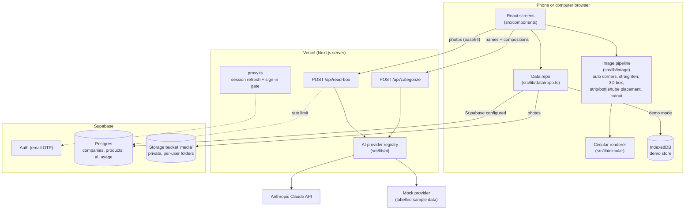
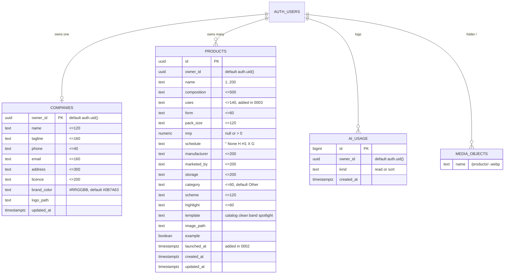
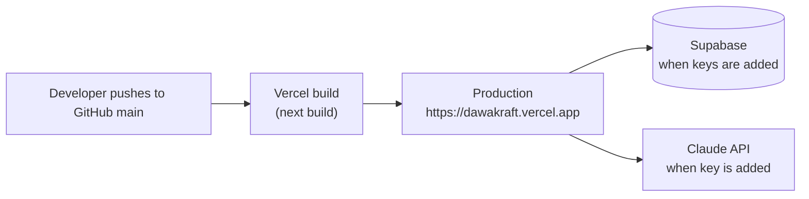

# Dawakraft architecture

> Status: living document. Last checked against the code on 2026-10-22.
> Decisions are recorded in [adr/](adr/README.md).

## 1. The stack, and why

| Layer | Choice | Version (package.json) | Why |
|---|---|---|---|
| Web framework | **Next.js App Router** | `next` 16.4.2 | One project for the public landing page, the app screens and the two small server functions that call the AI. Deploys to Vercel with no setup. |
| UI | **React** | 19.3.0 | Standard, well supported. |
| Language | **TypeScript** | ^5 | Catches mistakes before they reach users; shared types between browser and server. |
| Styling | **Tailwind CSS v4** plus hand-written CSS | `tailwindcss` ^4 | Tailwind provides the base and theme bridge; most styling is plain CSS classes driven by colour tokens in `src/app/globals.css` and `src/styles/*.css`. |
| Database, sign-in, photo storage | **Supabase** | `@supabase/supabase-js` ^2.118, `@supabase/ssr` ^0.12.7 | Postgres with row-level security, email magic-link sign-in and private file storage in one free-tier service. |
| AI reading | **Anthropic Claude** | `@anthropic-ai/sdk` ^0.135 | Reads printed carton text from photos and returns structured JSON. Model `claude-opus-5-5`. |
| Validation | **zod** | ^4.6.7 | One schema defines what the API accepts and what the AI must return. |
| Tests | **Vitest** | ^5.0.5 | Fast unit tests in Node. |
| Hosting | **Vercel** | n/a | Live at https://dawakraft.vercel.app, auto-deploys from GitHub `main` (set up in Vercel; there is no `vercel.json` in the repo). |

`next.config.ts` turns on `cacheComponents` and `partialPrefetching`, pins the Turbopack root to this folder and runs CSS through `@tailwindcss/turbopack`.

## 2. The big picture

Key idea: **almost everything happens in the browser.** Image processing, circular drawing, compliance checks and catalog sorting run on the phone. The server only exists to keep the Claude key secret and to apply sign-in and rate limits to AI calls.

## 3. Module map

### Routes (`src/app/`)

| Path | File | Who can open it | What it is |
|---|---|---|---|
| `/` | `page.tsx` | Everyone, indexed | Public landing page with JSON-LD. |
| `/catalog` | `(app)/catalog/page.tsx` → `components/Catalog.tsx` | Signed in (or demo) | Product grid, search and segments. |
| `/new` | `(app)/new/page.tsx` → `wizard/Wizard.tsx` | Signed in (or demo) | 5-step wizard. |
| `/product/[id]` | `(app)/product/[id]/page.tsx` → `ProductView.tsx` | Signed in (or demo) | Circular, share, download, delete. |
| `/product/[id]/edit` | `(app)/product/[id]/edit/page.tsx` | Signed in (or demo) | Wizard opened at step 3. |
| `/company` | `(app)/company/page.tsx` → `CompanyForm.tsx` | Signed in (or demo) | Branding. |
| `/import` | `(app)/import/page.tsx` → `ImportView.tsx` | Signed in (or demo) | CSV / paste import. |
| `/login` | `login/page.tsx` | Public, noindex | Email link + code sign-in. In demo mode it redirects to `/catalog`. |
| `/auth/callback` | `auth/callback/route.ts` | Public | Swaps the email link code for a session, then goes to `/catalog`. |
| `/api/read-box` | `api/read-box/route.ts` | See section 5 | AI box reading. |
| `/api/categorize` | `api/categorize/route.ts` | See section 5 | AI category sorting for imports. |
| `/robots.txt`, `/sitemap.xml` | `robots.ts`, `sitemap.ts` | Public | SEO files. |
| `/opengraph-image` | `opengraph-image.tsx` | Public | 1200 × 630 share card. |
| `/icon.svg`, `/pwa-icon/[size]` | `icon.svg`, `pwa-icon/[size]/route.tsx` | Public | Favicon and home-screen icons (180, 192, 512). |
| `/manifest.webmanifest` | `manifest.ts` | Public | PWA manifest. |

All app screens share `(app)/layout.tsx`: `ToastProvider` → `DataProvider` → `AppBar` + `DemoBanner` + page. That layout sets `robots: noindex, nofollow`.

### Libraries (`src/lib/`)

| Module | Runs in | Purpose |
|---|---|---|
| `config.ts` | Both | Decides **demo mode**: `supabaseConfigured` is true only when `NEXT_PUBLIC_SUPABASE_URL` and `NEXT_PUBLIC_SUPABASE_PUBLISHABLE_KEY` hold real values (not empty, not `your-…`/`example`/`placeholder`/`xxxx`). `demoMode = !supabaseConfigured`. Also `claudeConfigured()` and `demoAiAllowed()` (demo AI only when `NODE_ENV !== "production"`). |
| `ai/index.ts` | Server | **Provider registry.** `AI_PROVIDER=anthropic` → Claude (needs a real key, otherwise `not_configured`); `mock` → labelled sample answers; `off` → `not_configured`; unset or unknown → Claude if the key is real, otherwise mock. |
| `ai/types.ts` | Server (browser imports types only) | zod contracts: `BoxReadRequestSchema` (1–4 images, JPEG/PNG/WebP, base64 up to ~3 MB each, role front/side/top/other), `BoxReadingSchema` (11 fields, each `{value, confidence, source, quote}`), `CategorizeRequestSchema` (1–150 items), response envelopes `{ok:true,data,meta}` / `{ok:false,error}`, `AiProvider` interface with a `paid` flag. |
| `ai/providers/anthropic.ts` | Server | Claude via `beta.messages.parse` with zod structured output, `effort: medium` for reading and `low` for sorting, `max_tokens` 8000 / 16000, 2 retries, 90 s timeout, server-side fallback beta. Logs latency, tokens and an estimated USD cost to the server log. |
| `ai/providers/mock.ts` | Server | Fixed made-up carton ("Demozith 500"), every field `low` confidence, `meta.mock = true`, 600 ms delay; keyword-based sample categories. `paid: false`. |
| `ai/box-read.ts` | Both | The prompt, merging a reading into the form, evidence lines (`Read from side panel: "…"`), the "Sample reading" warning text. |
| `ai/access.ts` | Server | `checkAiAccess`: free providers skip checks; paid providers need a signed-in user (or local demo) and must pass the rate limit. |
| `rate-limit.ts` | Server | In-memory window per server instance, plus the shared `ai_usage` table count. |
| `image/perspective.ts` | Both (pure) | Corner ordering, aspect estimate, homography, bilinear `warpToRect`, `quadShare` (share of a photo covered by a detected face), depth consistency between left end (`side`) and top (warns over 20% mismatch). |
| `image/corners.ts` | Browser | Finds the box edges automatically from the background flood-fill mask (no manual dragging); falls back to a rectangle 8% inside the photo edges. |
| `image/straighten.ts` | Browser | Canvas glue: loads face photos up to 1600 px, straightens to a long side of 1200 px. |
| `image/packshot.ts` | Browser | Builds the 3D box from the straightened front, left end and top (view from the left, low camera, soft shadow). Size check per face (`MIN_FACE_SHARE`: front 20%, end and top 5%): an untrusted face is trimmed, or the photo is used as photographed. Fills a missing end or top from the front's edge colours. "Photos are cropped to the box" skips detection. |
| `image/companion.ts` | Browser (layout pure) | Places the cut-out strip, bottle or tube in front of the box's right end, sized and tilted as in the company catalogue. `shotLayout` is pure and unit-tested; strips are turned upright and tubes flat automatically. |
| `image/cutout.ts` | Browser | Background removal by flood-fill from the edges (tolerance slider, default 46). |
| `image/encode.ts` | Browser | Image loading, product image as WebP/PNG, logo blob, AI images shrunk to JPEG base64. |
| `faces.ts` | Browser | Photo roles: Front, Left end (`side`), Top, Strip / bottle / tube (`pack`, with its pack type), Other side. Only one photo per role. The AI receives `pack` photos as `other`. |
| `compliance.ts` | Both (pure) | The step-4 checklist. |
| `composition.ts` | Both (pure) | Strength checks: misread letters (`5O0`), numbers with no unit, front strength vs composition (allows combination totals like 625 = 500 + 125). |
| `segments.ts` | Both (pure) | New launch (`NEW_LAUNCH_DAYS = 60`), highlight auto-removal, company grouping, filter matching. |
| `circular/draw.ts`, `circular/render.ts`, `circular/catalogCard.ts` | Browser | The four layouts (Catalogue card, Clean, Side band, Spotlight) at 1080 × 1350 and PNG export. |
| `csv.ts` | Both | CSV / tab-separated parsing with header aliases, max 500 rows. |
| `format.ts`, `share.ts`, `color.ts` | Both / browser | MRP text, WhatsApp message, catalog list, Web Share, download, clipboard, colour helpers. |
| `data/repo.ts` | Browser | **Single data entry point.** Every read and write checks `demoMode` and goes either to Supabase or to `data/demo-store.ts`. |
| `data/demo-store.ts` | Browser | IndexedDB database `dawakraft-demo` with stores `products`, `company`, `media`. |
| `data/mappers.ts` | Both | Row ↔ object conversion, empty company and draft. |
| `supabase/client.ts`, `supabase/server.ts` | Browser / server | Supabase clients; `signedIn()` verifies the user with `auth.getUser()`. |
| `site.ts` | Both | Site name, URL (`NEXT_PUBLIC_SITE_URL`, default `https://dawakraft.vercel.app`), title, description, private paths. |

### `src/proxy.ts` (runs before pages)

Next.js 16 calls this file "proxy" (formerly middleware).

- **Demo mode:** every path opens; `/login` redirects to `/catalog`.
- **Supabase configured:** `/`, `/robots.txt`, `/sitemap.xml`, `/opengraph-image` and `/icon.svg` are public. Everything else refreshes the session cookie via `auth.getClaims()`. Signed-out visitors are sent to `/login`, except `/login`, `/auth/*` and `/api/*` (the API routes check sign-in themselves and answer with JSON). Signed-in visitors to `/login` go to `/catalog`.
- The matcher skips `_next/`, `favicon.ico`, `manifest.webmanifest`, `sw.js`, `pwa-icon`, `icon` and `apple-icon`.

## 4. Data model

From `supabase/migrations/0001_init.sql`, `0002_segments.sql` and `0003_uses.sql`.

- **Indexes:** `products (owner_id, created_at desc)`, `products (owner_id, launched_at desc)`, `ai_usage (owner_id, kind, created_at desc)`.
- **`launched_at`:** empty means an existing product. A product counts as a new launch for 60 days after this date (`segments.ts`); this is computed in the app, so nothing needs to run on a schedule.
- **Row-level security** is on for all three tables. `companies` and `products` allow all actions only where `owner_id = auth.uid()`. `ai_usage` allows only **select** and **insert** of your own rows: users can never edit or delete their usage log.
- **Storage:** bucket `media`, **private**, 5 MB file limit, only `image/webp`, `image/png`, `image/jpeg`. Four policies (read, insert, update, delete) all require the first folder of the path to equal the user's id. The app uploads to `<user id>/products/<product id>-<timestamp>.<ext>` and `<user id>/logo-<timestamp>.<ext>` (`repo.uploadMedia`).
- **Demo mode** keeps the same objects in IndexedDB, under user id `demo`.

## 5. API contracts

Both routes: `POST`, JSON body, `maxDuration = 120` seconds, response envelope `{ ok: true, data, meta }` or `{ ok: false, error }`.

| | `/api/read-box` | `/api/categorize` |
|---|---|---|
| Request | `{ images: [{ mediaType, data, role }] }`, 1–4 images | `{ items: [{ i, name, composition }] }`, 1–150 items |
| Success `data` | `BoxReading` (11 fields with value, confidence, source, quote) | `[{ i, category }]` |
| `meta` | `{ provider, model, mock, latencyMs, usage? }` | same |
| Rate limit (paid provider) | 20 per user per 10 minutes | 10 per user per 10 minutes |
| Errors | `bad_request` 400, `too_large` 413, `not_signed_in` 401, `image_rejected` 422, `refused` 422, `rate_limited` 429, `invalid_json` 502, `failed` 502 (503 if the usage check itself fails), `not_configured` 503 | `bad_request` 400, `not_signed_in` 401, `rate_limited` 429, `not_configured` 503, others 502 (503 if the usage check fails) |

Order of work in each route: pick provider → validate body with zod → `checkAiAccess` → call provider → map errors.

**Rate limiting has two layers** (`rate-limit.ts`):

1. `allow()`: an in-memory counter per server instance (stops rapid repeat taps; resets when the instance restarts).
2. `claimAiUse()`: inserts a row for this call into `ai_usage`, then counts the user's own rows of that kind in the last 10 minutes (row-level security limits the count to their rows). Inserting first means simultaneous requests all see each other, so they can't slip under the limit together. This is shared across all server instances.

Before any of this, `readJsonBody()` refuses request bodies over 13 MB with `too_large` (413), so oversized uploads are rejected before parsing.

In demo mode there is no user, so only layer 1 applies, and paid AI is only allowed when not running a production build (your own computer). The mock provider is `paid: false` and skips both sign-in and limits.

## 6. Security controls

| Control | How |
|---|---|
| Claude key never reaches the browser | Read only on the server (`ANTHROPIC_API_KEY`, no `NEXT_PUBLIC_` prefix). `.env*` files are git-ignored. |
| Each user sees only their own data | Postgres row-level security on every table; storage policies on per-user folders; private bucket. |
| Sign-in | Supabase email OTP (magic link and 6-digit code). The server verifies the user with `auth.getUser()` before any paid AI call. |
| Input validation | zod schemas on both API routes (sizes, counts, allowed image types, base64 characters). Database `check` constraints mirror the field limits; `csv.ts` trims to the same limits. |
| Cost control | Per-user rate limits, `max_tokens` caps, 90 s timeout, sign-in required for paid AI. |
| Honest AI output | Mock readings flagged `meta.mock`, shown with a warning; every field needs human confirmation. |
| Error messages | Users see plain messages; details go to the server log only (`console.error` in routes, `console.info` for usage). |
| JSON-LD injection | Landing page JSON-LD is static and escapes `<`. |
| Search engines | App screens and login are `noindex`; `robots.txt` disallows app paths. |

**Security headers:** `next.config.ts` sets `X-Content-Type-Options`, `X-Frame-Options: DENY`, `Referrer-Policy`, `Permissions-Policy` and `Strict-Transport-Security` on every page.

**Not in place yet (worth adding):** a full Content-Security-Policy, and a custom SMTP sender for Supabase emails (the built-in sender is limited to a few emails per hour).

## 7. Deployment

- Vercel builds every push to `main` and serves it at https://dawakraft.vercel.app.
- Environment variables are set in Vercel project settings: `NEXT_PUBLIC_SUPABASE_URL`, `NEXT_PUBLIC_SUPABASE_PUBLISHABLE_KEY`, `ANTHROPIC_API_KEY`, optionally `AI_PROVIDER` and `NEXT_PUBLIC_SITE_URL`. `NEXT_PUBLIC_` values are baked into the browser code at build time, so **redeploy after changing them**.
- Today no Supabase or Claude keys are set, so the live site runs in demo mode with the mock AI.
- The service worker (`public/sw.js`) registers only in production builds. It caches `/_next/static/` files and shows an offline page for navigations; pages and data always come from the network.

See [INTEGRATIONS](INTEGRATIONS.md) for each service and [TESTING](TESTING.md) for checks before deploying.
