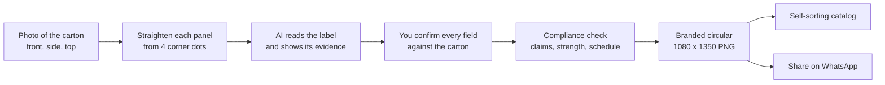

# Dawakraft product plan

> Status: living document. Last checked against the code on 2026-10-22.
> Related: [ARCHITECTURE](ARCHITECTURE.md) · [WORKFLOWS](WORKFLOWS.md) · [ROADMAP](ROADMAP.md)

## 1. Vision in one line

Take a phone photo of a medicine carton, and two minutes later have a branded, compliance-checked trade circular ready to send on WhatsApp, filed in a catalog that sorts itself.

## 2. Who it is for

| Audience | What they do today | What Dawakraft gives them |
|---|---|---|
| **Pharma distributors** | Announce new products to chemists in their area, often with hand-made or copied images. | A clean circular per product with their own logo, colour, contacts and licence numbers. |
| **PCD / franchise companies** | Keep many products and partners in step. | One consistent catalog, filterable by company, category and new launch, and a "Copy catalog list" message. |
| **Medical agents (MRs)** | Send product details to doctors and chemists between calls. | A circular and ready-written message in the time a call takes, from a phone. |

The product is built for India: rupee MRP, Indian Schedule H / H1 / X rules, `en-IN` language tag, WhatsApp as the main channel.

## 3. Problems it solves

1. **Making a circular is slow.** Today it needs a designer or a fiddly template app. Dawakraft draws three ready layouts (Clean, Side band, Spotlight) from the product details.
2. **Typing details from small print causes mistakes.** The AI reads the carton and, for every field, names the panel and quotes the printed text. The person still checks everything.
3. **A wrong strength is dangerous.** The app compares the strength printed on the front with the composition and blocks the circular if they disagree. It also flags numbers with no unit and letters read as digits (for example `5O0`).
4. **Promotional claims break the rules.** Words like "cure", "guaranteed", "100%", "best" or "No. 1" are caught and must be removed before a circular can be made.
5. **Product photos look amateur.** The app straightens each panel from four corner dots and builds a 3D pack shot from the real photos.
6. **Catalogs get messy.** Products sort by category, by company (with spellings like "Cipla Ltd." and "CIPLA LIMITED" grouped) and by new launch versus existing, and a new launch becomes existing by itself after 60 days.

## 4. Features and priority

Scores are 1 (low) to 5 (high). "Demo value" means how well it shows the product in a first meeting.

| Feature | Status | Impact | Effort | Demo value | Notes |
|---|---|---|---|---|---|
| 5-step wizard: Photos → Clean up → Details → Check → Circular | Built | 5 | 5 | 5 | The core of the product. |
| Corner dots and straightening per panel | Built | 4 | 4 | 5 | Auto-suggested corners, drag or arrow keys to adjust. |
| 3D pack shot from front + side + top | Built | 4 | 3 | 5 | Runs on the phone, costs nothing. |
| AI reading with evidence (panel + exact quote) | Built (Claude not yet keyed) | 5 | 4 | 5 | Mock provider active until a key is added. |
| Front strength vs composition cross-check | Built | 5 | 2 | 4 | Red item, blocks the circular. |
| Compliance checklist | Built | 5 | 2 | 4 | Claim words, missing fields, schedule warning, confirmation. |
| Three circular layouts with company branding | Built | 5 | 3 | 5 | 1080 × 1350 PNG. |
| Catalog with search and segments (launch, category, company) | Built | 4 | 3 | 4 | |
| New launch auto-expiry after 60 days | Built | 3 | 1 | 3 | Badge drops off the circular and message too. |
| Share on WhatsApp, download, copy message | Built | 5 | 2 | 5 | Needs a real phone to fully verify the share sheet. |
| CSV / Excel paste import with AI category filling | Built | 3 | 3 | 3 | Up to 500 rows; AI sorts up to 150 at a time. |
| Company profile (logo, colour, contacts, licence) | Built | 4 | 2 | 4 | |
| Email sign-in (magic link + code) and per-user data | Built, not connected | 5 | 2 | 2 | Waits for Supabase keys. |
| Demo mode with no account | Built | 4 | 2 | 5 | Data stays in the browser. |
| Install to home screen (PWA) | Built | 3 | 1 | 3 | Service worker only in production builds. |
| Public landing page with SEO basics | Built | 3 | 2 | 3 | See [SEO_PLAN](SEO_PLAN.md). |
| Automated end-to-end tests | Not started | 4 | 3 | 1 | See [TESTING](TESTING.md). |
| Magnifier while dragging a corner | Not started | 3 | 2 | 3 | See [ROADMAP](ROADMAP.md). |

## 5. Decisions and assumptions

These are deliberate. Changing any of them changes what the product is.

| Decision | Why | Where it lives in the code |
|---|---|---|
| **The product image is never AI-generated.** It is always the user's own photos, straightened, cut out or wrapped onto a 3D box. | A circular must show the real pack. A drawn pack could show the wrong strength, logo or design. | `src/lib/image/` (perspective, straighten, packshot, cutout). See [ADR 0004](adr/0004-on-device-pack-shots.md). |
| **The AI never invents "uses" or indications.** | There is no "uses" or indications field anywhere in the data model, prompt or circular. The AI is told to copy only printed text, never guess, never paraphrase. | `src/lib/ai/box-read.ts` (prompt), `src/lib/types.ts`, `supabase/migrations/0001_init.sql`. |
| **The person, not the AI, is responsible for the details.** | AI can misread small print. The user must tick "I checked these details against the printed carton" before the check step passes; composition is always marked "Check this" after a reading. | `DetailsStep.tsx`, `compliance.ts`, `Wizard.tsx`. |
| **Trade-only by design.** | Prescription medicines may not be advertised to the public in India. Every circular prints "For the use of registered medical practitioners, hospitals and licensed trade only." and every WhatsApp message ends "For licensed trade only." Schedule H, H1 and X get an extra warning. | `TRADE_LINE` in `constants.ts`, `circular/render.ts`, `format.ts`, `compliance.ts`. |
| **The compliance check is a safety net, not legal advice.** | It covers common problems only. The licence holder stays responsible, and the app says so on the check step and the landing page. | `CheckStep.tsx`, `src/app/page.tsx`. |
| **Demo mode without accounts.** | Anyone can try the full flow before any account or database exists. Data is kept only in that browser (IndexedDB). | `src/lib/config.ts`, `src/lib/data/demo-store.ts`. See [ADR 0002](adr/0002-demo-mode-browser-storage.md). |
| **AI is replaceable and the stand-in is labelled.** | The app runs with no AI key at all; sample readings are clearly marked as demo values and never pretend to be real. | `src/lib/ai/`. See [ADR 0003](adr/0003-provider-independent-ai.md). |
| **AI cost is capped per user.** | 20 box readings and 10 category sorts per user per 10 minutes, so one account can't run up the bill. | `src/app/api/*/route.ts`, `src/lib/rate-limit.ts`. |
| **Phone first.** | The users work from mid-range Android phones. Bottom navigation under 720 px, large touch targets on key controls, one-thumb flow. | `globals.css`, `AppBar.tsx`. |

### Assumptions we have not yet proven

- Distributors will photograph three panels (front, side, top) rather than only the front. The flat-front path exists as a fallback.
- The mock reading is enough to demo the flow; a real Claude reading still has to be tested on real cartons (see [TESTING](TESTING.md)).
- WhatsApp sharing of the image plus message works on the phones our users carry. Web Share with files is not available in every browser; the app falls back to a `wa.me` link with the message only.
- The cost per reading (estimated ₹2–15, see [INTEGRATIONS](INTEGRATIONS.md)) is acceptable to users or can be covered by a subscription.

## 6. What Dawakraft is not

- Not a public advertising tool for consumers.
- Not a source of medical information (no uses, dosage advice or claims).
- Not a full regulatory compliance service.
- Not an image generator.
