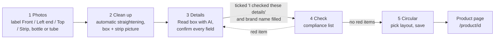
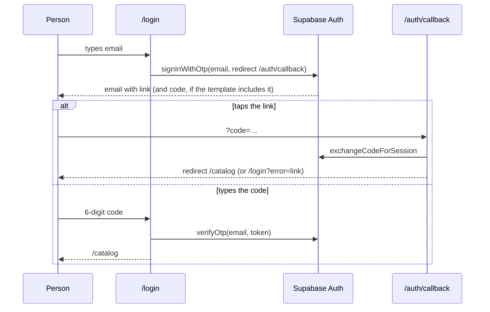

# Dawakraft workflows

> Status: living document. Last checked against the code on 2026-10-22.
> Related: [PRODUCT_PLAN](PRODUCT_PLAN.md) · [ARCHITECTURE](ARCHITECTURE.md) · [INTEGRATIONS](INTEGRATIONS.md) · [TESTING](TESTING.md)

Each journey below lists where it starts, what the person gives the app, what happens step by step, what data it relies on, what success looks like, what can go wrong and how to recover. Messages in quotes are the exact text the app shows.

**Two modes affect almost every journey** (see [section 9](#9-demo-mode) and [ADR 0002](adr/0002-demo-mode-browser-storage.md)):

- **Demo mode** (today, on the live site): no Supabase keys, so there is no sign-in and everything is saved in this browser only (IndexedDB).
- **Connected mode**: real Supabase keys, so people sign in by email and their data lives in Supabase.

---

## 1. New product wizard

**Entry point:** `/new` (the "New product" button in the catalog, "New" in the phone bottom bar, or "Photograph a box" on the empty catalog). Code: `src/components/wizard/Wizard.tsx`.

**Inputs:** 1 or more photos of the carton, the product details, a layout choice.

**The five steps:** Photos → Clean up → Details → Check → Circular. The step buttons at the top let you jump back to any step you have already reached, never forward past it.



### Step 1: Photos (`PhotosStep.tsx`)

1. Tap **Take photo** (opens the back camera on a phone) or **Choose from gallery** (several at once). Only image files are kept.
2. Each thumbnail has a drop-down: **Front**, **Left end** (the narrow side with the brand name, shown on the left as in a printed catalogue), **Top**, **Strip / bottle / tube** or **Other side**. The first photo starts as Front. There is one Front and at most one of each other role (`src/lib/faces.ts`).
3. When a Strip / bottle / tube photo is marked, a drop-down asks what it shows: **Strip (blister or alu-alu)**, **Bottle or vial** or **Tube**. The line next to the buttons says "· box with its strip or bottle", otherwise "· box only".
4. The advice on screen: one pack per photo, a dark plain sheet (white only for dark or amber bottles), daylight without flash, stand back and zoom in.
5. ✕ removes a photo. Changing photos or roles clears rotations and the prepared picture, so step 2 starts fresh.

**Next is blocked** ("Add a photo first") until there is at least one photo.

### Step 2: Clean up, automatic straightening (`CleanupStep.tsx`, `BoxCleanup.tsx`)

For a **box** (the default), there is nothing to place by hand ([ADR 0006](adr/0006-automatic-straightening-and-catalogue-product-picture.md)):

1. Each marked face (Front, Left end, Top) is loaded upright, at most 1600 px on its long side (`src/lib/image/straighten.ts`).
2. The app **finds the carton's corners** against the background (`src/lib/image/corners.ts`) and straightens the face to a flat rectangle (long side 1200 px). A detected face is trusted only if it covers at least 20% of its photo (front) or 5% (end, top) (`quadShare` in `perspective.ts`).
3. If it isn't trusted, the background is trimmed instead when that keeps the box, else the photo is used as photographed, and the status says "Couldn't find the edges of the … photo, so it's used as photographed. Retake it on a dark plain sheet, or crop it to the box in your phone's gallery and tick "Photos are cropped to the box"."
4. **Photos are cropped to the box** uses the box photos exactly as they are. **Rotate … 90°** buttons turn the front, left end, top or strip/bottle photo.
5. With **Show the box in 3D** ticked (default), the faces are drawn as a box seen slightly from the left with a sliver of the top, like the printed catalogue (`src/lib/image/packshot.ts`). Without a Left end or Top photo, those panels are filled in from the front's edge colours.
6. The **strip, bottle or tube** photo is cut out by flood-fill (**How much background to remove** slider, 12–120, default 46) and placed in front of the box's right end (`src/lib/image/companion.ts`): a strip stands taller than the box, slightly tilted; a bottle stands level; a tube lies across the front. If it can't be cut out it is left out and the status says so.

For a **bottle, tube or strip on its own**, tick **Not a box (bottle, tube or strip on its own)**. The background is removed by flood-fill from the photo edges instead (`src/lib/image/cutout.ts`), with the slider and a **Remove the background** tick box.

When **editing** without new photos, the saved picture is shown as is: "Using the saved photo. Add new photos in step 1 to replace it."

The straightened faces are kept: in step 3 they are sent to the AI instead of the tilted originals, so the small print is flatter and sharper.

If step 2 is skipped (jumping from step 1 to a later step), the pack shot is prepared in the background.

### Step 3: Details and AI reading (`DetailsStep.tsx`)

1. Tap **Read box with AI**. Up to 4 photos are sent, labelled ones first (front, side, top, then others). Each is shrunk to a JPEG of at most 1280 px (`aiImage` in `src/lib/image/encode.ts`). The status reads "Reading the box… this can take up to a minute."
2. The reply fills the form (`mergeAiResult` in `src/lib/ai/box-read.ts`):
   - Every field the reader wasn't sure of gets a yellow **Check this** flag. **Composition is always flagged**, because a misread strength is the most dangerous mistake.
   - Under each filled field an **evidence line** shows where it came from, for example `Read from side panel: "Each film coated tablet contains: Azithromycin IP 500 mg"`.
   - The status says, for example, "Filled 10 fields. Check every field against the carton, especially the ones marked Check this."
3. **Strength printed on the front** is filled from the reading (`strengthOnFront`, read from the front image only) and can be typed by hand.
4. Editing a field removes its Check this flag.
5. Optional fields: **Trade scheme** (e.g. 10+1 free) and **Highlight line** (max 28 characters).
6. **This is a new launch** is ticked by default for a new product and sets the highlight to "New launch" if it was empty.
7. The person must tick **I checked these details against the printed carton.**

If the reading came from the **mock provider**, a warning box appears instead of the summary: "Sample reading: these are demo values, not read from your photos. Replace every field with the carton's real details." and evidence lines start with "Demo value, not from your photos:".

**Next is blocked** ("Confirm the details first") until the confirmation is ticked and the brand name is filled. Changing any detail after reaching step 4 sends the person back through the check.

#### "Read box with AI" sequence

```mermaid
sequenceDiagram
  autonumber
  participant B as Browser (DetailsStep)
  participant R as POST /api/read-box
  participant G as Provider registry<br/>(src/lib/ai/index.ts)
  participant X as checkAiAccess<br/>(src/lib/ai/access.ts)
  participant A as Anthropic provider
  participant M as Mock provider
  participant C as Claude API

  B->>B: sort photos (front, side, top, other), max 4,<br/>shrink to JPEG base64
  B->>R: { images: [{ mediaType, data, role }] }
  R->>G: aiProvider()
  alt AI_PROVIDER=off, unknown value, or anthropic without a real key
    G-->>R: not_configured
    R-->>B: 503 { ok:false, error:"not_configured" }
  else provider chosen
    G-->>R: anthropic or mock
    R->>R: readJsonBody: over 13 MB → 413 too_large
    R->>R: zod BoxReadRequestSchema: invalid → 400 bad_request
    R->>X: checkAiAccess(provider, "read", 20 per 10 min)
    alt mock (paid: false)
      X-->>R: allowed, no sign-in or limit
      R->>M: readBox()
      M-->>R: fixed "Demozith 500" reading, all low confidence,<br/>meta.mock = true (after 600 ms)
    else anthropic (paid: true)
      X->>X: signed in? (or demo mode on your own computer)<br/>else 401 not_signed_in
      X->>X: in-memory limit + ai_usage insert-then-count<br/>else 429 rate_limited
      X-->>R: allowed
      R->>A: readBox(images)
      A->>C: messages.parse, model claude-opus-5-5,<br/>structured output = BoxReadingSchema
      C-->>A: 11 fields with value, confidence, source, quote
      A-->>R: data + meta (tokens, est. cost; logged on server)
    end
    R-->>B: 200 { ok:true, data, meta }
  end
  B->>B: mergeAiResult → fill fields, Check this flags,<br/>evidence lines, strength on front
```

### Step 4: Compliance check (`CheckStep.tsx`, `src/lib/compliance.ts`, `src/lib/composition.ts`)

The list is worked out live from the details. Each item is green (good), yellow (warn) or red (bad). **Any red item blocks Next** ("Fix the red items").

| Check | Level | Example message |
|---|---|---|
| Required fields: brand, composition, pack size, MRP > 0, manufacturer | warn if missing | "Missing: Pack size, MRP. Buyers expect these on a launch circular." |
| Details confirmed against the carton | **bad** if not ticked | "Go back to Details and confirm you checked them against the carton." |
| Claim words in name, highlight, scheme or composition: cure, guarantee, 100%, miracle, permanent, no side effects, instant relief, best, safest, No. 1, #1, risk-free | **bad** | "Remove claim words: cure, 100%. Circulars state facts only, never cures or guarantees." |
| Letters read as digits in the composition, e.g. `5O0` | **bad** | "Strength may be misread: check '5O0'" |
| A number in the composition with no unit | warn | "Composition has a number with no unit: 500. Add the unit as printed, e.g. mg." |
| **Front strength vs composition** | **bad** | "Front says 250, composition says 500 mg. Check the carton." |
| Schedule H, H1 or X | warn | "Schedule H product: share only with doctors, chemists and the licensed trade. …" |
| Trade-only footer | good (always) | "Trade-only line is printed in the footer of every circular." |
| Company name missing | warn | "Your company name is missing. Add it on the Company page." |

**The strength cross-check** passes when every number in "Strength printed on the front" appears in the composition (after fixing `O`→`0` and `l`→`1`). It also passes when a single front number equals the total of several strengths in the composition, for combination packs such as 625 = 500 mg + 125 mg. Recovery: go back to step 3 and correct the composition or the front strength; the red item clears at once.

The page ends with: "This check covers common problems, not the full law. The licence holder stays responsible for the final content."

### Step 5: Circular and save (`CircularStep.tsx`, `src/lib/circular/`)

1. The circular is drawn on the phone at 1080 × 1350 with the company branding, in one of four layouts: **Catalogue card** (a copy of the printed catalogue card, with the optional Uses line), **Clean**, **Side band**, **Spotlight**.
2. If "This is a new launch" is unticked, a "New launch" highlight is dropped from the circular.
3. **Save to catalog**:
   - Re-checks that the details are still confirmed and have no red items (people can jump back after passing step 4). If not: "Something changed since the check. Fix the red items first." and the wizard returns to step 3 or 4.
   - Uploads the product picture (WebP, or PNG where WebP isn't supported, long side at most 1080 px) to `<user id>/products/<id>-<time>.<ext>`.
   - Saves the product with its launch date (`nextLaunchedAt` in `segments.ts`).
   - Shows the toast "Saved to catalog" and opens `/product/<id>`.

**Data dependencies:** company profile (name, logo, colour, contacts, licence) from `DataProvider`; Supabase `products` table and `media` bucket, or IndexedDB in demo mode.

**Failure scenarios and recovery (whole wizard):**

| What happens | What the person sees | Recovery |
|---|---|---|
| A photo can't be opened | "A photo couldn't be opened. Go back, remove it, and choose a JPG or PNG photo." | Remove it in step 1 and choose another. |
| Box edges not found (e.g. a white carton on white paper) | "Couldn't find the edges of the … photo, so it's used as photographed. …" | Retake on a dark plain sheet, or crop the photo in the gallery and tick "Photos are cropped to the box". |
| Strip or bottle can't be cut out | "Couldn't separate the strip or bottle from its background, so it's left out for now. …" | Move the slider, or retake on a dark plain sheet. |
| Background removal fails (not a box) | "Couldn't separate the box from the background. Lower the slider, or retake the photo on a plainer surface." | Move the slider or retake the photo. |
| AI not set up (`not_configured`) | "AI reading isn't set up yet. Type the details from the carton." | Type the details, or add the Claude key ([INTEGRATIONS](INTEGRATIONS.md)). |
| Paid AI on the online demo (no sign-in) | "AI reading is switched off on the online demo until sign-in is added. Type the details from the carton." | Type the details; connect Supabase. |
| Sign-in expired | "Your sign-in expired. Reload the page and sign in again." | Reload and sign in. |
| Over the limit (20 readings per 10 minutes) | "AI is busy right now. Wait a minute, then try again." | Wait. |
| Claude rejects an image | "One photo couldn't be used. Try a different photo." | Replace the photo. |
| AI reply doesn't match the expected shape | "The AI reply couldn't be read. Try again." | Try again. |
| Any other AI failure, or request too large | "Couldn't read the box. Try again, or type the details." | Try again or type. |
| AI read nothing | "Couldn't read the box clearly. Type the details, or try sharper photos." | Sharper photos, or type. |
| Pack shot not ready when saving | "The photos couldn't be prepared. Go back to Photos and remove them or choose others." | Go back to step 1. |
| Upload or save fails | "Couldn't upload the photo. Check your connection and try again." / "Couldn't save. Check your connection and try again." / "Some details are too long or not valid. Shorten them and try again." | Fix and press Save again. A photo uploaded before a failed save is removed again. |

**Integrations:** `/api/read-box` and the AI provider (Claude or mock); Supabase database and storage in connected mode.

---

## 2. Edit a product

**Entry point:** **Edit details** on `/product/<id>`, which opens `/product/<id>/edit` (`src/app/(app)/product/[id]/edit/page.tsx`).

**Inputs:** the saved product; optionally new photos.

**Steps:**

1. The wizard opens **at step 3** with the saved details. Steps 1–3 are reachable; 4 and 5 open after the check, as for a new product. "This is a new launch" reflects whether the product is still within its 60 days.
2. To replace the picture, go back to step 1 and add photos. Without new photos, step 2 shows the saved picture.
3. Confirm the details again (the tick box starts unticked), pass the check, pick a layout, **Save to catalog**.
4. If a new picture was uploaded, the old one is deleted from storage after the save succeeds.

**Launch date rules on save** (`nextLaunchedAt`): unticking "new launch" clears the date (product becomes Existing); keeping it ticked while still new keeps the original date; ticking it on an old product starts a fresh 60 days (a relaunch).

**Failure:** "Product not found" with a link back to the catalog if the id doesn't exist. Save failures as in section 1.

---

## 3. Share and download

**Entry point:** `/product/<id>` (`src/components/ProductView.tsx`), reached from the catalog or right after saving.

**Steps:**

1. The circular is redrawn on the phone in the background as a PNG, so sharing can start straight from a tap. While a new layout renders, the old image is never handed out.
2. **Layout** buttons (Clean, Side band, Spotlight) change the saved layout at once.
3. **Download image** saves `<product-name>-circular.png` (toast "Image saved"). On iPhone and iPad the button reads **Show image to save**: the image is shown with "Press and hold the image to save it.", because iOS doesn't save downloads to Photos.
4. **Share on WhatsApp**: on a phone that can share files, the system share sheet opens with the image and message together; pick WhatsApp. Where file sharing isn't supported (most computers), `https://wa.me/?text=…` opens with the message filled in; attach the downloaded image.
5. **Copy message** copies the WhatsApp text (`shareText` in `src/lib/format.ts`): highlight and name in bold, composition, pack and MRP, scheme, company name and phone, and "For licensed trade only."
6. **Delete** asks "Delete this product from the catalog?" with **Delete** / **Keep**, then removes the product and its picture.

The highlight printed and shared is the *effective* one: "New launch" disappears by itself after 60 days.

**Failures:** "Couldn't create the image" if the PNG isn't ready; "Select the text and copy it manually" if the browser blocks copying; a cancelled share sheet does nothing.

**Integrations:** Web Share API, `wa.me` links, clipboard. These need a real phone to fully verify (see [TESTING](TESTING.md)).

---

## 4. Company branding

**Entry point:** `/company` ("Company" in the navigation, or "Set up company" from the catalog notice). Code: `src/components/CompanyForm.tsx`.

**Inputs:** logo image; company name; line under the name; phone / WhatsApp; email; address; drug licence numbers; brand colour (six swatches, or **Custom** colour picker).

**Steps:**

1. **Upload logo**: the image is shrunk to a PNG of at most 240 px and previewed. **Remove** clears it. Nothing is saved until **Save company**.
2. Fill in the fields. The preview on the right redraws a circular live (Clean layout) with the first real product, or the sample "Exampol 650".
3. **Save company**: uploads the new logo to `<user id>/logo-<time>.png`, saves the profile (one row per user), deletes the old logo, and shows "Saved. New circulars use this branding."

**Data:** `companies` table (or IndexedDB `company` store). Database limits: name 120, tagline 160, phone 40, email 160, address 300, licence 200 characters; colour must be `#RRGGBB`.

**Failures:** "That file couldn't be used as a logo" (bad file); save errors as in section 1. A logo uploaded before a failed save is removed again.

---

## 5. CSV import and AI categories

**Entry point:** `/import` (`src/components/ImportView.tsx`, `src/lib/csv.ts`).

**Inputs:** a CSV file, or rows pasted from Excel (tab-separated is detected from the first line). The first row names the columns. Accepted names include `name` / `brand` / `product`, `composition` / `generic`, `form` / `dosage form`, `pack` / `pack size` / `packing`, `mrp` / `price`, `manufacturer` / `manufactured by` / `company`, `category` / `therapeutic category`. Only **name** is required.

**Steps:**

1. **Upload CSV** (previews at once) or paste and press **Preview rows**. The first 12 rows show in a table, with "and N more".
2. Rows without a name are dropped; at most 500 rows are kept. Cells are trimmed to the database limits. A form not in the list becomes "Other"; a category not in the list is left empty.
3. If any row has no category, **Fill missing categories with AI** appears. It sends up to 150 rows (name and composition only) to `/api/categorize` (10 sorts per user per 10 minutes on a paid provider). The status says "Filled N categories. Check them in the preview." With the mock provider, it says "Sample categories (demo): check them. …" and uses simple keyword guesses.
4. **Import N products** saves them in chunks of 100, showing "Imported 100 of 340…". Imported products are **Existing** (no launch date) and use the Clean layout. Rows still without a category become "Other".

**Failures and recovery:**

| What happens | Message | Recovery |
|---|---|---|
| Fewer than 2 rows | "Add a header row and at least one product row." | Add a header and data. |
| No name column | "The first row needs a column called name." | Rename the column. |
| AI not set up | "AI sorting isn't set up yet (add your Claude key). You can still import; missing categories become Other." | Import anyway. |
| Paid AI on the online demo | "AI sorting is switched off on the online demo until sign-in is added. …" | Import anyway. |
| Over the limit | "AI is busy right now. Wait a minute, then try again." | Wait. |
| A chunk fails mid-import | "Imported 200. … The rows still shown were not imported." | Press Import again: only the unsaved rows remain, so no duplicates. |

---

## 6. Catalog segments and new-launch expiry

**Entry point:** `/catalog` (`src/components/Catalog.tsx`, `src/lib/segments.ts`).

**What the person can do:**

- **Search** by brand, composition, manufacturer, "marketed by" or category.
- Filter with three rows of chips, which combine:
  - **Launch:** All / New launches / Existing, each with a count.
  - **Category:** only categories that have products, with counts.
  - **Company:** the "Marketed by" company, or "Manufactured by" if none. Spellings are grouped by removing punctuation and words like Pvt, Ltd, Limited, LLP, Inc, Co, Corp, so "Cipla Ltd." and "CIPLA LIMITED" are one chip, labelled with the most common spelling.
- "Showing N products. **Clear filters**" appears when any filter is on.
- **Copy catalog list** copies only the products currently shown, as a WhatsApp-ready list with "Orders: <phone>" at the end.
- Product cards show the circular thumbnail and **New launch** / **Example** tags.

**New-launch expiry:** a product is a new launch while less than **60 days** (`NEW_LAUNCH_DAYS`) have passed since `launched_at`. This is worked out every time the catalog is shown, so nothing runs on a schedule. When it expires, the product moves to Existing and a "New launch" highlight disappears from its circular and WhatsApp message.

**States:** loading skeletons; "No products yet" with **Photograph a box** and **See an example** (adds the sample "Exampol 650" marked Example); "No products match" ("Try another search or category."); a notice with **Remove examples** when examples exist; a notice inviting the person to set up the company when the name is empty.

**Failure:** "The catalog couldn't load. Reload the page to try again." Recovery: reload.

---

## 7. Sign-in (when Supabase is configured)

**Entry point:** any app page while signed out redirects to `/login` (`src/proxy.ts`). Code: `src/app/login/page.tsx`, `src/app/auth/callback/route.ts`.



**Steps:** type a work email → **Email me a sign-in link** → "We sent a sign-in email to …. Tap the link in it, or type the code here." → tap the link, or type the code and press **Sign in**. **Use another email** starts again. **Sign out** is in the top bar.

**Failures:** "Enter a valid email address."; "Couldn't send the email. Wait a minute and try again." (Supabase's built-in sender allows only a few emails per hour); "That code didn't work. Check it, or send a new email."; a link that expired or opened in another browser lands on `/login?error=link` with "That link has expired or was opened in another browser. Type the code from the email instead, or send a new one."

**Note:** the code is only in the email if the Supabase Magic Link template includes `{{ .Token }}` (README step 1.4).

**Status:** built, not connected (no Supabase keys yet). Not tested end to end.

---

## 8. Public home page

`/` is a public landing page (`src/app/page.tsx`): hero with a live circular cycling through the layouts (paused when the person prefers reduced motion), "How it works", features, who it is for, FAQ, and **Try the free demo** / **Open the app** links to `/catalog`. See [SEO_PLAN](SEO_PLAN.md) and [ADR 0005](adr/0005-public-landing-and-catalog-route.md).

---

## 9. Demo mode

**When:** `NEXT_PUBLIC_SUPABASE_URL` or `NEXT_PUBLIC_SUPABASE_PUBLISHABLE_KEY` is empty or still a placeholder (`src/lib/config.ts`). This is the state of the live site today.

**What changes:**

| Area | Demo mode |
|---|---|
| Sign-in | None. Every page opens; `/login` redirects to `/catalog`. |
| Data | IndexedDB database `dawakraft-demo` in this browser (`products`, `company`, `media`), under user id `demo`. Other devices and browsers don't see it; clearing site data deletes it. |
| Banner | A yellow notice on every app screen. On your own computer it explains how to add Supabase keys; on the online site it says data is saved only in this browser. |
| AI | Depends on the provider (see [INTEGRATIONS](INTEGRATIONS.md)). The free **mock** works everywhere and is clearly labelled. A paid provider (Claude) is allowed only when not running a production build, i.e. on your own computer; online it answers `not_signed_in`, shown as "AI reading is switched off on the online demo until sign-in is added." |
| Sign out | Hidden. |

**Recovery from lost demo data:** none; it lived only in that browser. Connect Supabase for lasting storage.
